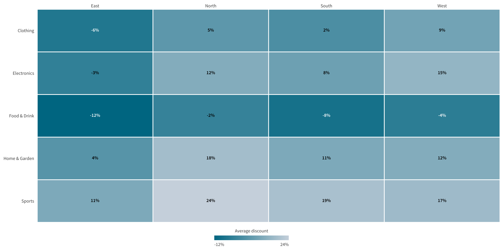

# Getting started

Add Tm Heat Grid to a sheet and give it data. These steps use the Qlik Cloud edit mode.

1. Open the sheet and choose **Edit sheet**.
2. Open the Custom objects panel and drag **Tm Heat Grid** onto the sheet.
3. Add two dimensions. The first dimension sets the columns. The second dimension sets the rows.
4. Add a measure. It sets the cell color.
5. Optionally add a second measure. It adds a second value to each cell.
6. Choose **Done editing**.

## Choose the color

Open **Color** in the property panel. Choose **Sequential** for a measure that runs from low to high. Choose **Diverging** for a measure with a meaningful middle, such as a variance. Set the midpoint to the middle value.

## Choose the labels

Open **Cell labels** in the property panel. Choose a layout:

- **Inline** prints both values on one line.
- **Stacked** prints the values on two lines.
- **Primary only** prints the primary measure.

## Limits

The chart needs two dimensions and one or two measures. The default row limit is 10,000 rows. Raise **Maximum rows** in **Appearance** up to 50,000 rows.

